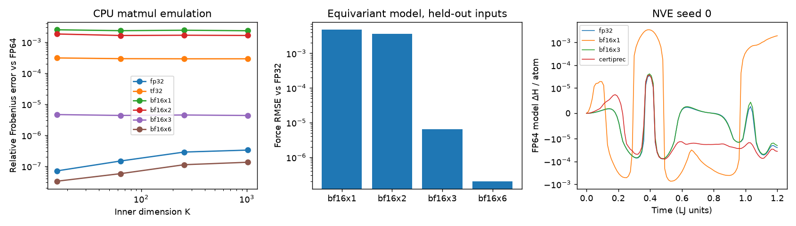
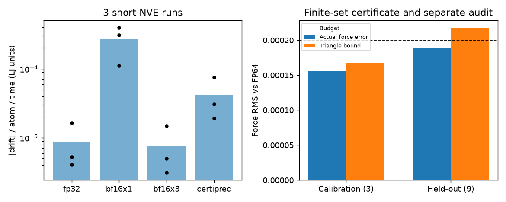

# certiprec-mlip

<p>
  <a href="https://antigravity.google/"></a>
  <sub>This project uses API credits from the Google Antigravity for Science program. Thank you, Google Antigravity!</sub>
</p>
<br clear="left">


Adaptive BF16xk precision for equivariant machine-learning interatomic
potentials. Inspired by FACTO's three-product FP32 emulation, this prototype
chooses precision per layer and measures force error and NVE energy drift.
**GPU results: PENDING. JAX/TPU: PENDING.**

BF16x3 splits each operand into leading BF16 slices and uses
`Xhi @ Whi + Xhi @ Wlo + Xlo @ Whi`, with FP32 residuals and accumulation.
BF16x1, asymmetric BF16x2 and BF16x6 provide other accuracy/cost choices.

The default model has actual scalar and vector channels: cuEquivariance
spherical harmonics, channelwise tensor products, equivariant linear mixing,
and quadratic scalar invariants. An original torch CPU interpreter evaluates
its segmented descriptors with selectable precision in forward and backward.
The earlier radial-only model remains as a baseline.

Certification has a limited scope: the local matmul bound assumes normal-range
arithmetic, and the force certificate checks a finite configuration set using
a telescoping triangle inequality. It does **not** guarantee drift on unseen
trajectories. The adaptive policy's held-out triangle bound misses its budget
in the recorded experiment. No measured speedup is claimed.

## Install and run

Python 3.10+ and CPU torch work. From this repository:

```bash
python -m pip install -e '.[test,reference]'
python -m pytest -q
python scripts/run_v0.py --profile --torch-profiler
python scripts/make_figures.py
```

The recorded run used `/workspace/venv/bin/python`, torch `2.15.0+cpu`, and
cuEquivariance `0.13.0` from Yani Guan's reference fork. To reproduce using
that read-only clone, copy its packages with symlinks resolved before installing:

```bash
CUEQ_COPY=$(mktemp -d)
cp -aL /workspace/ref_cueq/cuequivariance "$CUEQ_COPY/"
cp -aL /workspace/ref_cueq/cuequivariance_torch "$CUEQ_COPY/"
/workspace/venv/bin/python -m pip install "$CUEQ_COPY/cuequivariance" "$CUEQ_COPY/cuequivariance_torch"
/workspace/venv/bin/python -m pip install -e '.[test,reference]'
```

`--quick` uses 30 fit configurations and 120 MD steps, retaining three seeds.
`--steps`, `--dt`, `--seeds`, `--configs`, `--threads`, `--force-budget` and
`--out` are available. Defaults are 60 configurations, 600 steps, dt=0.002,
three seeds and one CPU thread. `configs/v0.yaml` describes these defaults;
the script reads command-line flags. Profiling can also use
`CERTIPREC_PROFILE=1`. Torch profiler output is a short text table.

Runs resume automatically from each completed experiment or seed/policy JSON;
source, argument and package-version hashes prevent reuse of stale stages.
Use `--no-resume` to rerun. The fit is recreated deterministically and requires
no checkpoint. Figure generation writes `results/v0/figs/`. The legacy small
`mlip_lj.pt` and partial `run_log.txt` are not used for the new evidence.

## Measured evidence

An eight-atom free LJ cluster is the toy system, in reduced units with unit
mass. Only 45 linear readout parameters are fitted to energy and force labels;
the equivariant backbone uses fixed seeded features. There are 48 fit and 12
validation configurations. NVE measures the FP64 Hamiltonian of this same
fitted model; the analytic LJ Hamiltonian is not the conserved quantity used
for the precision comparison. Three seeds share initial conditions across
policies, each running 600 steps over 1.2 time units.

<!-- Evidence rows below are filled from results/v0 JSON, not the legacy log. -->

| Claim | Experiment / script | Result file | Actual number |
| --- | --- | --- | --- |
| Local matmul bounds hold on tested cases | `run_v0.py` matmul | [matmul.json](results/v0/matmul.json) | 24/24 matrix cases pass |
| BF16x3 matmul accuracy, K=256 | `run_v0.py` matmul | [matmul.json](results/v0/matmul.json) | Relative error 4.48639e-06; BF16x1 0.00240365 |
| Toy LJ fit quality | `run_v0.py` + `fit_equivariant` | [fit.json](results/v0/fit.json) | Validation force RMSE 0.0049956; energy RMSE/atom 2.9295e-05 |
| Interpreter agrees with cuEq CPU reference | `run_v0.py` layer check | [layer_errors.json](results/v0/layer_errors.json) | Max absolute output error 4.76837e-07 |
| FP32 rotation check, one configuration | `run_v0.py` rotation check | [layer_errors.json](results/v0/layer_errors.json) | Force RMS 6.1041e-07; total energy error 4.76837e-07 |
| Uniform BF16x3 stays close to FP32 | `run_v0.py` layer errors | [layer_errors.json](results/v0/layer_errors.json) | Force RMSE 6.47274e-06; energy RMSE/atom 2.7409e-06 |
| Adaptive policy meets calibration budget | `run_v0.py` allocation | [allocation.json](results/v0/allocation.json) | Triangle bound 0.000167699 <= budget 0.000199213, on 3 configs |
| Held-out certificate does not meet budget | `run_v0.py` separate audit | [allocation.json](results/v0/allocation.json) | Triangle bound 0.000217348 > 0.000199213, on 9 configs |
| Estimated adaptive product cost | `run_v0.py` allocation | [allocation.json](results/v0/allocation.json) | 0.997299 times uniform BF16x3; no measured speedup |
| fp32 short NVE drift | `run_v0.py` + `run_nve` | [nve.json](results/v0/nve.json) | Mean absolute drift 8.60308e-06; mean detrended RMS 2.59835e-05 |
| bf16x1 short NVE drift | `run_v0.py` + `run_nve` | [nve.json](results/v0/nve.json) | Mean absolute drift 0.000272174; mean detrended RMS 0.000999554 |
| bf16x3 short NVE drift | `run_v0.py` + `run_nve` | [nve.json](results/v0/nve.json) | Mean absolute drift 7.61576e-06; mean detrended RMS 2.5849e-05 |
| certiprec short NVE drift | `run_v0.py` + `run_nve` | [nve.json](results/v0/nve.json) | Mean absolute drift 4.18662e-05; mean detrended RMS 2.54209e-05 |

At K=256 the relative matmul errors are:

| Mode | Error vs FP64 |
| --- | --- |
| fp32 | 2.87444e-07 |
| tf32 | 0.000288948 |
| bf16x1 | 0.00240365 |
| bf16x2 | 0.00165988 |
| bf16x3 | 4.48639e-06 |
| bf16x6 | 1.12469e-07 |

Drift units in the evidence table are energy / atom / time; detrended RMS is
energy / atom. Every number comes from completed CPU JSON. The final full run
took **32.3 seconds** with profiling enabled. Individual
seed traces are in `nve_seed{seed}_{policy}.json`.

The selected policy is `['bf16x2', 'bf16x3', 'bf16x3', 'bf16x3', 'bf16x3']`, ordered as spherical harmonics,
edge tensor product, atom linear, quadratic invariants, and readout. Its
modeled product saving is only **0.270%**.
Its measured drift exceeds uniform BF16x3. On the held-out audit its pooled
actual force RMS is 0.000188135, but the conservative triangle
bound does not meet the budget. This demonstrates the limits of allocation
from three calibration inputs. An online controller or a uniform bound is
needed before calling an unseen trajectory certified.





Validation: **29 pytest tests pass**, covering split reconstruction, arithmetic
bounds, batched backward, FP32 rotation/translation/permutation behavior,
cuEq CPU forward/gradient agreement, BF16x3 accuracy, allocation feasibility,
finite-set certificate checks, and short NVE runs. CI repeats the tests and a
quick three-seed experiment. Run identity: `566e7c0cc7b964c6`.

## Pending

- **GPU results: PENDING.** Open [the A100 Colab notebook](notebooks/colab_a100.ipynb),
  which clones this repository, installs cuEquivariance frontends and CUDA ops,
  and runs [colab_a100_bench.py](scripts/colab_a100_bench.py). It writes small
  `results/gpu/*.json` files. The notebook has no executed cells or GPU numbers.
- Dense GPU GEMMs compare FP32, TF32 and BF16xk with explicit FP32 outputs.
  Real cuEq `fused_tp` kernels are benchmarked separately with BF16-rounded
  slice passes using FP32 math. The runner rejects a naive fallback. A fused
  BF16 tensor-core cuEq backend and native TF32 support in that TP API are not
  implemented. GPU model forces, MD and speedups remain **PENDING**.
- Global force/drift certificates, online or per-atom policies, larger models,
  longer NVE runs and JAX/TPU execution are **PENDING**.

See [DESIGN.md](docs/DESIGN.md) for the math, assumptions, drift link and port
plan, and [BORROWED.md](docs/BORROWED.md) for exact upstream functions, revision,
Apache-2.0 attribution, CPU reference checks and backend precision behavior.
